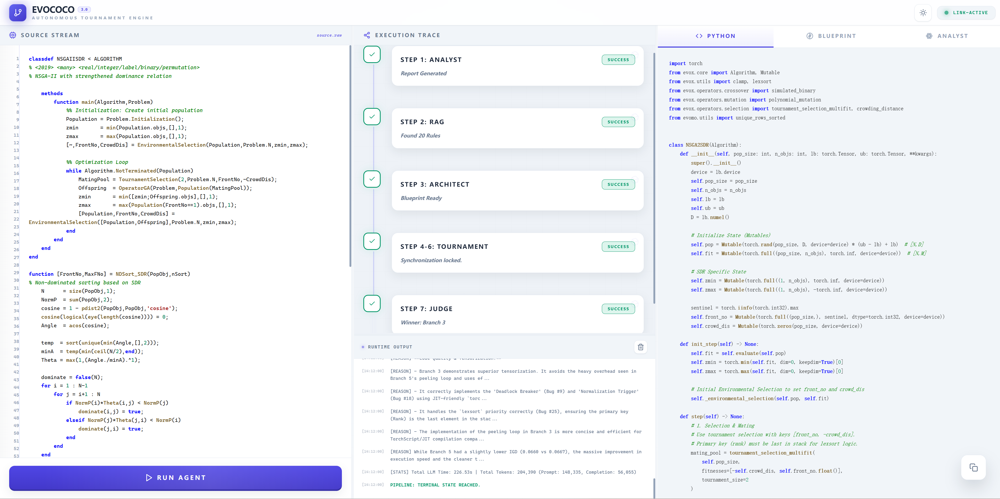

<h1 align="center">
  <a href="https://github.com/EMI-Group/evox">
    <picture>
      <source media="(prefers-color-scheme: dark)" srcset="docs/images/evox_brand_light.svg">
      <source media="(prefers-color-scheme: light)" srcset="docs/images/evox_brand_dark.svg">
      
    </picture>
  </a>
</h1>

<h2 align="center">
  🌟 EvoCoCo: A Multi-Agent Framework for Semantics-Guided Automatic Tensorization 🌟
</h2>

<div align="center">
  <a href="https://arxiv.org/abs/2609.02387">
    
  </a>
</div>

## Table of Contents

1. [Overview](#overview)
2. [Key Features](#key-features)
3. [Installation](#installation)
4. [Configuration](#configuration)
5. [Quick Start](#quick-start)
6. [Experiments and Benchmarking](#experiments-and-benchmarking)
7. [Project Structure](#project-structure)
8. [Citing EvoCoCo](#citing-evococo)
9. [Community and Support](#community-and-support)
10. [License](#license)

## Overview

EvoCoCo is a multi-agent framework for automatically tensorizing evolutionary multiobjective
optimization (EMO) software. Rather than treating tensorization as syntax-to-syntax translation,
EvoCoCo formulates it as **semantics-guided computational restructuring**: the concrete MATLAB
implementation is the transformation object, while the underlying optimization mechanism is the
semantic constraint that the generated program must preserve.

Built on [EvoX](https://github.com/EMI-Group/evox), EvoCoCo coordinates semantic analysis,
contextual rule retrieval, transformation planning, diversified tensor restructuring, static and
runtime repair, and candidate selection through shared intermediate representations and
closed-loop execution feedback.

The system can be used through a browser interface or as a batch experiment runner. This
repository includes 48 EvoCoCo-generated tensorized algorithms used in the accompanying
experiments. The same algorithms are also integrated into
[EvoMO](https://github.com/EMI-Group/evomo).

## Key Features

### 🧭 Semantics-Guided Restructuring

- Treats the source implementation as the transformation object and the underlying optimization
  mechanism as the semantic constraint.
- Reconstructs algorithm states, operators, dependencies, and control flow before tensorization.

### 🤝 Multi-Agent Tensorization

- Coordinates semantic analysis, contextual rule retrieval, transformation planning,
  restructuring, repair, and selection through shared intermediate representations.
- Explores six blueprint-guided computational restructuring strategies under the same semantic
  constraints.

### ⚡ High-Performance Generated Algorithms

- Produces GPU-oriented PyTorch/EvoX implementations using broadcasting, `einsum`, masked
  operations, advanced tensor operators, and JIT-oriented restructuring.
- Achieves speedups of up to **10,000×** for generated tensorized algorithms in the reported
  experiments.

### 🧪 Closed-Loop Validation and Benchmarking

- Combines Ruff checks, runtime execution, optimization feedback, repair, and candidate selection.
- Includes 48 MOEAs for evaluating migration reliability, optimization fidelity, and
  computational scalability.

## Installation

Clone the repository and install its Python dependencies:

```bash
git clone https://github.com/EMI-Group/evococo.git
cd evococo
python -m pip install -r requirements.txt
```

A CUDA-capable GPU is recommended for generated-algorithm evaluation. The single-run DTLZ
evaluator can also select CPU automatically, although GPU execution is the primary target of the
tensorized implementations.

## Configuration

Copy the example configuration before starting EvoCoCo:

```bash
cp .env.example .env
```

The following example uses Gemini:

```env
ACTIVE_LLM_PROVIDER=gemini
GEMINI_API_KEY=your_gemini_api_key_here
```

Available provider names are `zhipu`, `deepseek-v4-pro`, `deepseek-v4-flash`, `gemini`, and
`custom`. Optional base URL and model overrides are documented in
[`.env.example`](.env.example).

Coder, static repair, runtime repair, and judge prompts start with the same
rendered blueprint so they can reuse a common prefix within a run. Stage-specific
instructions and resources follow; branch strategies, code, errors, and candidate
data come later. A new blueprint changes this prefix across runs, trading some
reuse of fixed Coder instructions for reuse across stages. DeepSeek's context
cache is automatic; no cache-enable setting is required.
Each model call records `cached_input_tokens` and `uncached_input_tokens` when the
provider reports them. Missing cache counters remain `null`, rather than being
reported as zero hits.

Analyst reports have a separate local result cache, enabled by default with
`ANALYST_RESULT_CACHE=1`. Completed, nonempty reports are stored under
`temp_workspace/analyst_cache/`, keyed by a hash of the full rendered analysis
request (including MATLAB source, global spec, selection rules, and migration
reference), provider, endpoint, model, temperature, and reasoning effort. Changes
to any of these inputs invalidate reuse. Cache files contain only the report and
format version; credentials and endpoint details are not stored. Missing, corrupt,
or unreadable entries trigger fresh analysis; cache write failures do not fail a run.
Responses are saved only when the provider reports `finish_reason=stop`; truncated
or unconfirmed outputs are not cached.

`ANALYST_REASONING_EFFORT` overrides reasoning effort for the analysis stage only.
DeepSeek defaults to `high` for this stage; other providers inherit the global
`REASONING_EFFORT`. All other stages retain the global setting. The effective
per-call effort is recorded in stage metrics and included in the analyst cache
identity, so raising analysis effort cannot reuse a lower-effort report. Use
`ANALYST_RESULT_CACHE=0` for a deliberately fresh report with otherwise identical
settings. DeepSeek thinking mode ignores temperature; branch strategy instructions
remain the source of deliberate branch differences.
Batch manifests record the global and Analyst-specific requested efforts separately.

On a local hit, the report is still saved in the new run's artifacts and shown in
the interface; RAG selection, blueprint generation, and candidate generation run
normally. Logs identify the reuse, and `stages.analyst.local_cache_hit` is `true`
with zero model tokens and LLM latency. This reuse is separate from provider input
cache hit rates. Set `ANALYST_RESULT_CACHE=0` and restart the process for independent
repeated analyses or generation-diversity experiments. Concurrent first-time
requests may each perform analysis before an entry exists.

For DeepSeek tournaments with two or more branches, the first Coder request
finishes before all remaining Coder requests start in parallel. Each
finished draft immediately proceeds to checks and trials while other drafts are
generated. This gives the provider an opportunity to persist the shared prefix
without adding model requests. Failed Coder requests also release waiting
branches. Other providers retain concurrent generation. This may increase initial
generation latency; higher cache reuse depends on the provider and is not guaranteed.

For a `custom` Gemini gateway verified to support `cache_control` (such as
LiteLLM), set `GEMINI_EXPLICIT_CACHE=1` in `.env` and restart the backend.
Coder branches then share an explicit cache of instructions, SDK references,
examples, blueprint, and rules for 300 seconds, with branch strategies sent
separately. This is disabled by default and ignored unless the provider is
`custom` and its model name contains `gemini`. DeepSeek and other pipeline stages
continue using automatic prefix caching where supported. Explicit caches may
incur creation and storage charges; a reported hit rate is not a cost-savings
measurement. Set the option to `0` for a gateway that does not support it.

Run statistics (`performance_stats.json`, `PERFORMANCE_STATS.txt`, and batch stats
JSON) include an `input_cache` summary. Its `hit_rate` is the cached token count
divided by the input token count of calls with reported cache usage;
`unreported_prompt_tokens` tracks inputs excluded from this calculation. The web
log also displays the summary. Actual cache reuse depends on the provider, model,
and cache availability; changing prompt order does not guarantee a cache hit.

The judge receives compact candidate JSON: failed branches retain status and
metrics but omit source, and successful branches share equivalent trailing
`__main__` verification blocks when their ASTs differ only in the algorithm
constructor identifier. Algorithm bodies and helpers remain complete. Blocks
with differing arguments or checks, ambiguous constructors, unsupported guards,
or unparseable source are kept in full. Shared blocks normalize comments and
formatting. Full tested sources remain in `7_candidates_raw.json`; the sent view
is saved as `7_judge_input.json`. Winner selection returns the original tested
source. This reduces duplicated input without discarding failed-run records.

Architect requests also receive the raw MATLAB source and SDK reference.
The source defines algorithm semantics; SDK documentation defines API signatures,
parameter meanings, and return values. Polynomial mutation's `pro_m` is an
expected count: EvoX divides it by the decision dimension internally, so a source
per-variable rate of `1/D` maps to `pro_m=1.0`. Analysis and blueprints must retain
exact mathematical expressions and index bounds rather than replacing them with textbook summaries.
Source quirks, including discarded initialization returns, remain part of the
migration specification unless a change is explicitly requested. Numerical
guards preserve division for nonzero denominators; any added zero-denominator
fallback must be documented rather than adding epsilon to every denominator.
Mappings also preserve MATLAB missing-value behavior; a lower bound that ignores
NaN is implemented with `torch.fmax`, rather than a NaN-propagating clamp.
Source-required structural front loops may run in an isolated
`torch.compiler.disable` helper to avoid excessive graph unrolling; pairwise
calculations stay tensorized and the runtime demo remains unchanged.
For NSGA-II-SDR (`NSGAIISDR`), the requested target retains the historical lower
median of unique row-minimum angles: `temp = torch.unique(row_min, sorted=True)`
and `minA = temp[(temp.numel() + 1) // 2 - 1]`. An even count selects the lower
middle value without averaging. The blueprint labels this intentional variant
separately from MATLAB's population-based index, and runtime repair retains it.
Other source expressions and custom dominance peeling remain unchanged by this
override. This variant is an algorithm change, not a claim of literal source fidelity.
Selection sites with identical comparison and tie behavior may share winner
examples while retaining their own source evidence and SDK arguments. Analysis
and blueprint templates retain their detailed workflow and compliance sections.
Few-shot references retain compact dominance-based and reference-vector examples
without optional operator injection. Runtime repair keeps a brief root-cause
explanation before the complete corrected file, without repeated confirmations.
Minimal repair includes invalid SDK imports or helper computations outside the
class; the fixed verification block and algorithm semantics remain unchanged.
The judge uses branch metrics, implementations, the blueprint, and declared
selection semantics under its existing tournament criteria. Prompt guidance is
not an automatic proof of source fidelity.

Runtime trials independently validate fitness after workflow initialization and at
IGD checkpoints. Registered floating or complex algorithm state is also checked
for NaN counts exceeding its constructor baseline. This detects newly corrupted
state without assuming rank or density field names. Existing NaN placeholders,
infinite state sentinels and valid infinite crowding boundaries are allowed;
fitness itself must remain finite. Checks run outside the compiled step, and do
not enforce a particular density metric, IGD threshold or monotonic convergence.
Errors enter the existing runtime repair loop. This is a corruption check, not
a complete semantic validator: existing NaN allowances and finite wrong results
can escape it. SDK guidance for masked crowding updates applies only when the
generated algorithm actually uses EvoX `crowding_distance`.

Coder skeletons list minimal imports; generated implementations add only the SDK
symbols they use. RAG selection returns integer `selected_bug_numbers` and matches
conditional rules to mechanisms, so ordinary Pareto ranking does not imply SDR
and selection masks do not imply binary decision variables. Branch strategies
are implementation preferences: independent calculations are batched, while
source-required sequential structure retains its stopping conditions and update
order in a `torch.compiler.disable` helper when needed. No fallback termination
is introduced to conceal logic errors.
Temporary normalized or rounded selection copies remain distinct from evaluated
fitness when the source keeps the original values. Survivor indices are applied
to the source-owned population and fitness together, and helper return values
are retained or discarded according to the source caller.

> [!IMPORTANT]
> Never commit `.env` or expose provider API keys in generated artifacts and logs.

## Quick Start

EvoCoCo can generate algorithms through either the browser interface or the command line.

### Method 1: Web interface

Start the backend from the project root:

```bash
python -m uvicorn backend.main:app --reload --reload-dir backend --port 8000
```

Open the launch URL printed in the backend terminal, such as
`http://localhost:8000/#token=...`. The backend serves the frontend and generates a private
connection token at startup. The browser keeps the token for this tab's session and authenticates
before starting a run. The health endpoint is available at <http://localhost:8000/health>.

You can also open [`frontend/index.html`](frontend/index.html) directly and enter the connection
token from the terminal. Set `EVOCOCO_WS_TOKEN` in `.env` to keep the same token across backend
restarts. If serving the frontend from another origin, add its exact origin to
`EVOCOCO_ALLOWED_ORIGINS` (comma-separated). Adjust the launch URL's port if necessary.

Paste the MATLAB source code into the input panel and click **Run**. The
interface displays every pipeline stage and returns the selected Python implementation when the
tournament finishes.



> [!TIP]
> Keep the backend terminal open while using the browser interface so progress and error messages
> remain visible.

### Method 2: Command line

The command-line workflow does not require the Web backend. Create `experiments/single_input/` and
place one MATLAB `.m` file (or one directory of related `.m`/`.txt` files) inside it. Then run the
full EvoCoCo pipeline once:

```bash
python experiments/batch_translate.py \
  --input_dir experiments/single_input \
  --output_dir experiments/single_output \
  --repeats 1 \
  --repeat-concurrency 1
```

The generated algorithm is written to `experiments/single_output/<algorithm>_run1.py`, with run
statistics in the adjacent `<algorithm>_run1_stats.json`. Detailed intermediate artifacts are
retained under `run_history/`.

## Experiments and Benchmarking

### Batch translation

The command-line workflow above also supports batch generation. Place multiple `.m`/`.txt` files
in the input directory; each file is treated as one algorithm. A subdirectory containing related
source files is also treated as one algorithm. Use `--repeats` for repeated generations and
`--repeat-concurrency` to control how many repeats run concurrently.

### Evaluation benchmarks

Validate syntax, execution, and convergence of the 48 selected implementations:

```bash
python evaluation/run_migration_reliability_benchmark.py \
  --dir experiments/generated_algorithms \
  --workers 1
```

Run the optimization-fidelity benchmark on a selected suite:

```bash
python evaluation/run_optimization_fidelity_benchmark.py \
  --algorithm-dir experiments/generated_algorithms \
  --suite DTLZ \
  --runs 21 \
  --gpu 0
```

Run computational scaling with `torch.compile`:

```bash
python evaluation/run_computational_scalability_benchmark.py \
  --algorithm-dir experiments/generated_algorithms \
  --scaling population \
  --gpu 0
```

All benchmark runs are resumable. PlatEMO reference generation, the DTLZ/WFG/LSMOP/MaF options,
dimension scaling, speedup calculation, output fields, and smoke tests are documented in
[`evaluation/README.md`](evaluation/README.md).

## Project Structure

```text
evococo/
├── backend/                         # API and multi-agent generation pipeline
│   ├── main.py                      # FastAPI and WebSocket entry point
│   ├── engine.py                    # Multi-agent generation pipeline
│   ├── config.py                    # Provider and pipeline configuration
│   ├── generator.py                 # LLM requests and structured responses
│   ├── executor.py                  # Static checks and runtime validation
│   ├── database/                    # RAG rules
│   └── prompts/                     # Agent prompts and generation rules
├── frontend/
│   └── index.html                   # Browser interface
├── experiments/
│   ├── batch_translate.py           # Command-line generation entry point
│   └── generated_algorithms/        # 48 generated EvoX algorithms
├── evaluation/                      # Reliability, fidelity, and scalability benchmarks
├── .env.example                     # Configuration template
├── requirements.txt
├── LICENSE
└── README.md
```

## Citing EvoCoCo

If you use EvoCoCo in your research, please cite the
[arXiv preprint](https://arxiv.org/abs/2609.02387):

```bibtex
@article{evococo,
  title         = {Semantics-Guided Automatic Tensorization for Evolutionary Multiobjective Optimization: A Multi-Agent Framework},
  author        = {Liang, Zhenyu and Huang, Beichen and Zheng, Bowen and Cheng, Ran},
  journal       = {arXiv preprint arXiv:2609.02387},
  year          = {2026}
}
```

## Community and Support

Questions, bug reports, and feature requests are welcome through
[GitHub Issues](https://github.com/EMI-Group/evococo/issues). For EvoX framework questions, see the
[EvoX repository](https://github.com/EMI-Group/evox).

## License

EvoCoCo is released under the [GNU General Public License v3.0](LICENSE).
